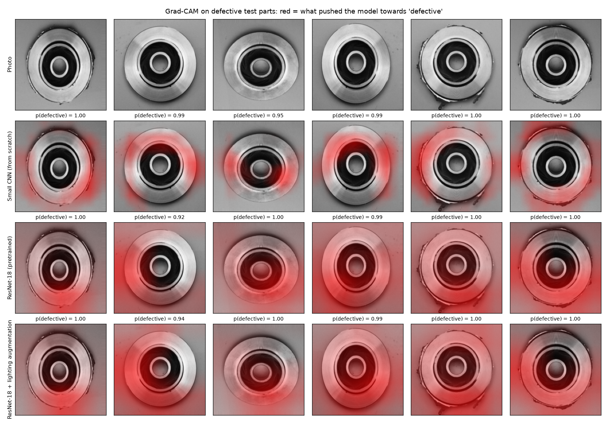

# Casting Defect Inspector

A CNN that looks at a top-view photo of a cast metal part and decides: **pass** or **reject**.

- It compares a small CNN trained from scratch with a pretrained ResNet-18.
- The reject threshold is chosen by cost, because a defective part that ships costs more than a
  good part that is scrapped.
- It checks what the model is really using: Grad-CAM heatmaps, a lighting-only baseline, and
  photos that are darker, blurred or noisy.

Built with Python, PyTorch and Streamlit. The core is about 450 lines across 6 small files, and
everything was trained on a laptop CPU.

## How it works

### Data

```
1,300 original photos (781 defective, 519 ok), 512 x 512
   -> stratified split: 780 train / 260 validation / 260 test   (saved in data/split.csv)
   -> resized to 224 x 224 grayscale
   -> training photos only: random rotation, flip, brightness and contrast
```

The part is round and photographed from above, so a rotated or flipped photo is still realistic.

**Why I did not use the dataset's ready-made split.** The dataset also ships a 300 x 300 folder
that is already split into train (6,633 photos) and test (715 photos). `scripts/check_kaggle_split.py`
compares the files: **64 of the 715 test photos (9.0%) are byte-for-byte identical to a training
photo.** A score on that test folder is partly a score on photos the model has already seen, so I
made my own split from the 1,300 original photos, which contain no identical files.

### Models

```
small_cnn       5 convolution blocks -> average pool -> 1 output     about 390,000 weights, from scratch
resnet18        ImageNet-pretrained ResNet-18, all layers fine-tuned  about 11 million weights
resnet18_relit  the same ResNet-18, trained with much wider brightness changes (0.5x to 1.5x)
```

Each model outputs one number per photo, p(defective). Training keeps the weights from the epoch
with the lowest validation loss.

### Decision

```
photo -> p(defective) -> reject if p >= threshold
threshold = the value with the lowest cost on the validation photos
cost      = 10 x missed defects + 1 x good parts rejected
```

The 10-to-1 ratio is my assumption, set in `inspector/config.py`. A real factory would supply it.

## Files

| File | What it does |
|---|---|
| `app.py` | Streamlit UI: upload a photo, get the verdict, probability and Grad-CAM heatmap |
| `inspector/data.py` | Split, resize, cache and augmentation |
| `inspector/models.py` | The small CNN and the ResNet-18 wrapper |
| `inspector/train.py` | Training loop |
| `inspector/metrics.py` | Scores, cost-based threshold, confidence intervals |
| `inspector/gradcam.py` | Grad-CAM heatmaps |
| `inspector/config.py` | All settings |
| `scripts/check_kaggle_split.py` | Counts test photos that also appear in the dataset's train folder |
| `eval/run_eval.py` | Evaluation pipeline |
| `tests/` | 36 unit tests |

## Results

Measured by `python eval/run_eval.py` on 10 Oct 2026. Full output is in
[eval/results.md](eval/results.md). Every number is from the 260 test photos (156 defective,
104 ok), which were not used for training or for choosing thresholds.

**Test results at the cost-based threshold**

| Model | Threshold | Accuracy | Defects caught | Missed defects | False rejects | Cost |
|---|---|---|---|---|---|---|
| Small CNN (from scratch) | 0.16 | 92.3% | 153/156 (98.1%) | 3 | 17 | 47 |
| ResNet-18 (pretrained) | 0.09 | **98.8%** | **155/156 (99.4%)** | 1 | 2 | **12** |
| ResNet-18 + lighting augmentation | 0.52 | 99.2% | 154/156 (98.7%) | 2 | 0 | 20 |

- The pretrained ResNet-18 makes 3 mistakes; the small CNN makes 20.
- The two ResNet-18 versions differ by one missed defect. On 260 photos that is not a real
  difference: the 95% interval for accuracy is 96.7% to 99.6% for one and 97.2% to 99.8% for the other.

**Does the cost-based threshold help?**

| Model | Threshold | Missed defects | False rejects | Cost |
|---|---|---|---|---|
| Small CNN | 0.50 | 10 | 8 | 108 |
| Small CNN | 0.16 | 3 | 17 | 47 |
| ResNet-18 | 0.50 | 2 | 0 | 20 |
| ResNet-18 | 0.09 | 1 | 2 | 12 |

Lowering the threshold trades missed defects for false rejects. For the small CNN it catches 7
more defects at the price of 9 more good parts rejected, and the cost falls from 108 to 47.

**How many labelled photos are needed?**

| Model | Training photos | Accuracy | Missed defects | False rejects | ROC AUC |
|---|---|---|---|---|---|
| Small CNN | 78 | 93.1% | 7 | 11 | 0.9769 |
| Small CNN | 780 | 92.3% | 3 | 17 | 0.9885 |
| ResNet-18 | 78 | 93.8% | 2 | 14 | 0.9938 |
| ResNet-18 | 780 | 98.8% | 1 | 2 | 0.9997 |

With only 78 labelled photos the pretrained model already ranks photos better (AUC 0.9938) than
the small CNN does with all 780 (0.9885). Accuracy is measured at each model's own threshold, so
AUC is the fairer column to compare.

**Shortcut check: can lighting alone predict the label?**

| Model | Accuracy | ROC AUC |
|---|---|---|
| Always answer "defective" | 60.0% | 0.500 |
| Logistic regression on brightness, contrast and background brightness | 78.1% | 0.860 |

This baseline cannot see any defect, yet it is right 78% of the time. Defective photos are darker
on average (139 against 149 on a 0 to 255 scale). So the dataset contains a shortcut: a CNN can
score well partly by reading the lighting.

**Photos the models never saw in training**

Accuracy, with the share of defects caught in brackets.

| Condition | Small CNN | ResNet-18 | ResNet-18 + lighting augmentation |
|---|---|---|---|
| Clean test photos | 92.3% (98.1%) | 98.8% (99.4%) | 99.2% (98.7%) |
| Darker (60% brightness) | 61.9% (99.4%) | 95.0% (98.7%) | 98.8% (98.1%) |
| Brighter (130% brightness) | 86.5% (90.4%) | 97.7% (98.1%) | 99.2% (98.7%) |
| Out of focus (blur) | 59.2% (98.7%) | 80.8% (100.0%) | 91.5% (93.6%) |
| Sensor noise | 51.2% (76.9%) | 76.2% (99.4%) | 82.7% (95.5%) |
| Low resolution (96 px) | 69.2% (92.3%) | 81.9% (100.0%) | 91.2% (98.7%) |

The same runs as a cost, with missed defects + false rejects in brackets.

| Condition | Small CNN | ResNet-18 | ResNet-18 + lighting augmentation |
|---|---|---|---|
| Clean test photos | 47 (3 + 17) | 12 (1 + 2) | 20 (2 + 0) |
| Darker | 108 (1 + 98) | 31 (2 + 11) | 30 (3 + 0) |
| Brighter | 170 (15 + 20) | 33 (3 + 3) | 20 (2 + 0) |
| Blur | 124 (2 + 104) | 50 (0 + 50) | 112 (10 + 12) |
| Sensor noise | 451 (36 + 91) | 71 (1 + 61) | 108 (7 + 38) |
| Low resolution | 188 (12 + 68) | 47 (0 + 47) | 41 (2 + 21) |

- The small CNN is fragile. On darker photos it rejects 98 of the 104 good parts, which fits the
  shortcut: darker looks "defective" to it.
- Lighting augmentation removes the false rejects on darker photos (11 down to 0) and raises
  accuracy in every condition.
- It is not a clear win on cost. Under blur and noise the augmented model misses more defects
  (10 and 7, against 0 and 1), and at 10 to 1 that costs more than the false rejects it saves.
  The plain ResNet-18 fails in the safer direction: when unsure it rejects.

**Speed on a laptop CPU (Intel i5-11300H, no GPU)**

| Model | Time per photo | Training time |
|---|---|---|
| Small CNN | 13 ms | 13 min |
| ResNet-18 | 91 ms | 21 min |

**Grad-CAM**



These are the first six defective test photos in file order, not hand-picked. The heatmaps are
coarse (14 x 14 for the small CNN, 7 x 7 for ResNet-18) and cover large areas, including the
background in several photos. They do not isolate the defect, so they do not prove the model is
looking at the right thing. Together with the lighting baseline, I read them as a warning, not as
reassurance.

### How to read these numbers honestly

- The test set is 260 photos. One mistake is 0.4 points of accuracy, so small gaps between models
  mean nothing.
- All photos come from one camera setup and one part type. The lighting shortcut shows the scores
  depend on that setup; they would not carry over to another line without new photos.
- I removed identical files between splits, but I cannot tell whether two different photos show
  the same physical part. If they do, the test score is still optimistic.
- Each model was trained once with one random seed. The small CNN's validation loss jumps a lot
  between epochs, and its best epoch scored 96.9% on validation but 93.1% on test at the same 0.5
  threshold, so picking the best epoch flattered it.
- The 78-photo runs each use one random subset. A different subset would give different numbers.
- The darker, blurred and noisy photos are simulated on a computer, not taken in a worse factory.
- One defective test photo (`cast_def_0_2483.jpeg`) is missed by all three models, and I cannot see
  a defect in it at this resolution either. It may be subtle or mislabelled.

## Run it

Needs Python 3.11+. No GPU and no Kaggle account are needed; the 100 MB dataset downloads on first use.

```powershell
python -m venv .venv
.venv\Scripts\Activate.ps1
pip install -r requirements.txt

python scripts/check_kaggle_split.py        # the leak check on the ready-made split
python -m inspector.train small_cnn         # about 13 minutes on CPU
python -m inspector.train resnet18          # about 21 minutes
python -m inspector.train resnet18_relit    # about 21 minutes
python eval/run_eval.py                     # a few minutes

streamlit run app.py
```

Other commands:

```powershell
python -m pytest tests                                  # unit tests
python -m inspector.train resnet18 --fraction 0.1       # train on 10% of the photos
python -m inspector.train small_cnn --fraction 0.1
```

## Explaining it in an interview

**Two-minute version**

> It is a quality-inspection model: a CNN that classifies photos of cast metal parts as defective
> or ok. I compared a small CNN trained from scratch with a pretrained ResNet-18 that I fine-tuned.
> Before training I checked the dataset's ready-made split and found that 9% of its test photos are
> identical to training photos, so I built my own split from the 1,300 original photos. On 260
> held-out photos the ResNet-18 reaches 98.8% accuracy and catches 155 of 156 defects; the small
> CNN reaches 92.3%. I chose the reject threshold by cost, assuming a missed defect costs ten
> times a false reject. Then I tested what the model relies on. A logistic regression on
> brightness alone gets 78%, so the photos contain a lighting shortcut, and the small CNN falls to
> 62% on darker photos. Stronger brightness augmentation fixed the lighting failures, but under
> blur and noise it missed more defects, so it was not a clear win.

**Questions you are likely to get**

*What is a convolution and why use it for images?*
A small filter (3 x 3 here) slides over the image and responds to a local pattern such as an edge.
The same filter is used everywhere, so a scratch is detected wherever it appears, and the model
needs far fewer weights than a fully connected layer on 50,000 pixels.

*What does your small CNN look like?*
Five blocks of convolution, batch normalisation and ReLU, with the channels growing 16, 32, 64,
128, 256 while the image shrinks from 224 to 14 pixels. Then global average pooling, dropout and
one linear output. About 390,000 weights.

*Why pooling?*
It halves the image size, which cuts computation and lets later filters see a larger area of the
original photo. Global average pooling at the end turns the feature maps into one vector whatever
the image size, with no extra weights.

*What is transfer learning and why did it win?*
ResNet-18 was already trained on 1.2 million ImageNet photos, so its early layers detect edges
and textures. I replaced the last layer with one output and fine-tuned everything at a low
learning rate. It starts with useful features; the small CNN has to learn them from 780 photos.
With 78 photos the pretrained model still ranks parts better than the small CNN does with 780.

*The photos are grayscale. How do you feed them to an ImageNet model?*
I copy the single channel three times and normalise with the ImageNet mean and standard deviation,
inside the model, so training, evaluation and the app all send the same input.

*Why did you not use the provided train/test split?*
I hashed every file. 64 of the 715 test files are exact copies of training files. A model can
memorise those, so the score would be too high. I also could not link the other photos back to
their originals, so I used the 1,300 original photos and split them myself.

*Why not accuracy alone?*
The two mistakes do not cost the same. A missed defect reaches a customer; a false reject scraps
one good part. I report both counts and one cost number, and the 60/40 class balance means
"always defective" already scores 60%.

*How did you choose the threshold?*
On the validation photos I tried thresholds from 0.01 to 0.99 and kept the one with the lowest
cost. If several tie, I take the middle one. The test photos are never used for this.

*What is Grad-CAM and what did it show?*
It takes the gradient of the "defective" score with respect to the last convolution layer's
feature maps, weights each map by its average gradient, and adds them up to get a heatmap. Mine
are coarse and often cover the background, so they did not confirm that the model looks at defects.

*How did you find the shortcut?*
The heatmaps and the failure on darker photos made me suspicious, so I trained a logistic
regression on three numbers per photo that describe only the lighting. It reached 78% against a
60% baseline. Defective photos are simply darker on average in this dataset.

*What did you do about it?*
I trained the same ResNet-18 with brightness changed randomly between 0.5x and 1.5x, so brightness
stops being a reliable clue. False rejects on darker photos went from 11 to 0. But it missed more
defects under blur and noise, so I would not ship it on that evidence alone.

*Why augmentation, and which ones?*
Rotation and flips, because the part is round and seen from above, plus small brightness and
contrast changes. Each epoch the model sees a slightly different version of every photo, which
reduces overfitting on 780 photos. Only training photos are augmented.

*How do you know it is not overfitting?*
I keep the weights from the epoch with the lowest validation loss and report on a separate test
set. For the small CNN the validation score was noisy and higher than the test score, which I
state in the results.

*Could this run on a production line?*
The ResNet-18 needs about 91 ms per photo on a laptop CPU and the small CNN 13 ms, so speed is
fine. What is missing is evidence from the real line: its camera, its lighting and its defect rate.

## Limitations and what I would do next

- Collect photos from a second camera or lighting setup and test on those. That is the only real
  check of the shortcut.
- Crop or mask the background so the model can only see the part.
- Add blur and noise to the augmentation, then re-check the missed defects.
- Use 5-fold cross-validation and several seeds; 260 test photos and one run are too few to
  separate the two ResNet-18 versions.
- The model says only "defective". It does not say what kind of defect or where; that needs
  labelled defect locations and a segmentation or detection model.
- Check how well the probabilities are calibrated before trusting a threshold as low as 0.09.

## Data source

- "Casting product image data for quality inspection" on Kaggle
  (`ravirajsinh45/real-life-industrial-dataset-of-casting-product`). This project uses the 1,300
  photos in its `casting_512x512` folder for training and testing, and its `casting_data` folder
  only for the leak check.
